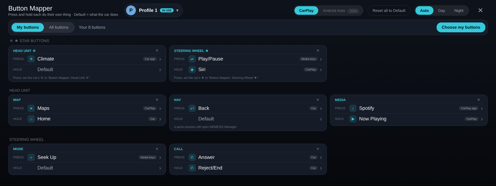
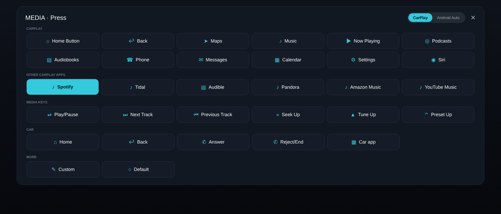

# Gen5W Button Mapper

An [HMG-API](https://github.com/Open-HMG/HMG-API) mod for Hyundai, Kia and Genesis cars with a Gen5W head unit that lets you choose what your car's buttons do. On the car it's called **Button Mapper**. Every button gets two choices: one for a short **press** and one for a **hold** (about 0.8 s). Each can open a CarPlay screen or app, send a media key, open any screen on the car, or stay what the car does on its own (**Default**, which is where everything starts).

By DeFlight, LLC.

 

> [!IMPORTANT]
> **CarPlay only for now. Android Auto isn't supported yet.** The phone choices (screens, apps, Siri, media keys) work with Apple CarPlay. The **Android Auto** side of the CarPlay | Android Auto switch is shown as **SOON** and can't be picked. Car, Seek, Tune and Preset choices work whatever phone you use, or with none.

## Contents

- [What you can set](#what-you-can-set)
- [The setup screen](#the-setup-screen)
- [Profiles](#profiles)
- [The star buttons ☆ ★](#the-star-buttons--)
- [What each choice does](#what-each-choice-does)
- [Buttons that can't be set](#buttons-that-cant-be-set)
- [Good to know](#good-to-know)
- [Requirements](#requirements) · [Compatibility](#compatibility) · [Install](#install)
- [Support](#support)

## What you can set

| Where | Buttons |
|---|---|
| ☆ ★ Star buttons | Head Unit ☆, Steering Wheel ★ |
| Head unit | HOME, MAP, NAV, MEDIA, RADIO, PHONE, SETUP, SEEK UP/DOWN, TUNE UP/DOWN |
| Steering wheel | MODE, CALL, VOICE, MUTE, SEEK UP/DOWN (the ∧ ∨ buttons) |
| Overhead | POI, CONNECT (Bluelink / Kia Connect) |

Not every car has every button. **Choose my buttons** (below) lets you keep only yours.

**Press and Hold are separate.** For each button you can change the press, the hold, both, or neither. For example, MAP's press could open CarPlay Maps while its hold still does what the car does. Setting a Hold replaces the car's own hold for that button. The button's short press then reaches the car when you let go, a fraction of a second later than usual.

## The setup screen

Open the **Button Mapper** tile in the car's app menu. Every change saves at once; there's no Apply and no restart.

- **My buttons | All buttons** (top of the screen): My buttons shows the buttons you chose. All buttons shows every button your car's model can have, and you can set any of them from there. Until you've chosen your buttons, All buttons shows.
- **Choose my buttons:** every button your model can have, each with a checkbox. Tap a card to check or uncheck it, or press the button on the car (hold the ☆ ★ buttons; their press belongs to the car, see below). While choosing, your presses go to the setup screen, so pressing a button won't take you away from it.
  - **Done:** the checked buttons become My buttons. Unchecked buttons go back to Default and leave My buttons.
  - **Cancel** (or leaving the screen, or 5 minutes without a tap): nothing changes.
- **A button's card** has a **Press** row and a **Hold** row. Tap a row to pick what it does. The icon and the small tag on the right show what it's set to.

  

- **✕** at the top right of a card (My buttons) removes that button. It asks first, then sets the button's press and hold back to Default and takes it out of My buttons. All buttons still lists it.
- **Reset all to Default** puts every button's press and hold back to what the car does, for the profile you're editing. It asks first.
- **CarPlay | Android Auto:** which phone the phone choices go to. Android Auto is coming; for now it shows as **SOON** and can't be picked.
- **Auto / Day / Night**: the screen follows the car's day and night display (Auto), or stays light or dark.

A button set to anything other than Default always shows in My buttons. Choices made from All buttons are kept until you change them; only ✕, unchecking it in Choose my buttons, or Reset all puts a button back to Default.

## Profiles

Each of the car's user profiles (Profile 1, Profile 2 and Guest) has its own buttons and its own My buttons.

- **The chip next to the title** shows the profile you're editing, with its name and picture from the car. **IN USE** marks the profile whose buttons are working now. Tap the chip to pick a profile to edit.
- **Follow the car's profile** (in the same pop-out, on by default): when the car switches profile, that profile's buttons take over. With it off, the profile you pick stays in use.
- **Editing a profile that isn't in use:** an orange bar says so, with:
  - **Copy [profile]'s buttons:** replaces this profile's buttons and My buttons with the in-use profile's. It asks first.
  - **Use now:** this profile's buttons take over now. With Follow on, the car's next profile switch changes it again.
- **Pictures:** a picture synced from the phone app shows. A profile using one of the car's own pictures shows its first letter instead; the car doesn't give out those pictures.
- The first time Button Mapper starts, everything belongs to the profile the car is on.

## The star buttons ☆ ★

Most cars have two star buttons: **☆ on the head unit** and **★ on the steering wheel**. They work differently from every other button, because of how the car and HMG-API handle them:

**The press of a star is chosen in the car's own settings, not in Button Mapper.** The car decides what a star press does, in its Button settings (Setup → Button → Custom Button ☆ / ★). Button Mapper adds two entries to that list:

- **Button Mapper: Head Unit ☆**
- **Button Mapper: Steering Wheel ★**

To make a star's press do what you set in Button Mapper:

1. In the car's Button settings, set that star to the matching Button Mapper entry. Both entries show on both stars' lists, so pick the one for that star.
2. In Button Mapper, set that star's **Press** row.

If the car's setting for a star is anything else (Navigation, Phone, and so on), the star does that and the Button Mapper **Press** row has no effect.

**The hold of a star is set in Button Mapper.** It works like every other button's hold. Setting it replaces the car's own hold, which normally opens that star's settings screen. You can still reach those settings from Setup → Button.

Every choice works for a star's press, including Seek, Tune and Preset, which the car's home menu sends for it.

## What each choice does

**CarPlay** (needs a phone connected):

| Choice | What it does |
|---|---|
| Home Button | CarPlay's own home button: from an app to the Dashboard, from the Dashboard to the app grid |
| Back | One step back in the CarPlay app on screen |
| Maps, Music, Now Playing, Podcasts, Audiobooks, Phone, Messages, Calendar, Settings | That CarPlay screen |
| Siri | Starts Siri, as the steering wheel's voice button does |

**Other CarPlay apps** (needs a phone connected): Spotify, Tidal, Audible, Pandora, Amazon Music, YouTube Music, Waze, Google Maps, WhatsApp and Claude, if the app is on the iPhone. They show a generic icon; the apps' logos belong to their owners.

**Media keys:**

| Choice | What it does |
|---|---|
| Play/Pause, Next Track, Previous Track | CarPlay's media keys (needs a phone connected) |
| Seek Up / Seek Down | The car's own SEEK press, in whatever is playing: radio, USB, Bluetooth or CarPlay. Works without a phone |
| Tune Up / Tune Down | The car's own TUNE press. Works without a phone |
| Preset Up / Preset Down | The steering wheel's ∧ / ∨ press. In the radio this changes presets or seeks, depending on the car's own ∧ / ∨ setting. Works without a phone |

Play and Pause can't be separate choices. When CarPlay connects, the car tells the phone either "Play/Pause toggle" or "separate Play and Pause", never both. The phone ignores the separate ones, so Button Mapper uses the toggle.

**Car** (works without a phone):

| Choice | What it does |
|---|---|
| Home | The car's own HOME button |
| Back | The car's own back, like the ‹ at the top left of the screen |
| Car app | A screen on the car, picked from a list (see below) |

**Car app** list:

- **Common:** the car's home menu items in its own order and names (Map, Radio, Media, Navigation Menu, Voice Memo, User's Manual, HD Radio Data, Quiet Mode, Hyundai Pay, Apple CarPlay, Warmer/Ventilation, Climate, Notifications, EV, Phone, Bluelink, Valet Mode, Setup), then the settings screens, NEMESIS Manager, HMG-API and Button Mapper. Only what's installed on your car shows.
- **Added apps:** apps installed on top of the car's software, such as other mods' apps (for example Comfort & Startup). Found automatically.
- **Other apps:** everything else, behind a tap.

They open the way the car's home menu opens them.

**More:**

| Choice | What it does |
|---|---|
| CarPlay: Custom | A CarPlay app by the link name you type in the box, for example `calshow` for Calendar. Leave off the trailing `:`; capital letters are kept. If the phone doesn't know the name, nothing happens |
| Default | What the car does with that press, as if Button Mapper weren't installed |

## Buttons that can't be set

| Button | Why |
|---|---|
| **Volume** (knob, wheel + / −) | Left alone on purpose, so you always have volume control |
| **Power** | HMG-API never lets a mod take it |
| **SOS** (overhead emergency call) | HMG-API never lets a mod take it. Your emergency call always works |
| **N1 / N2 and N Grin Shift** (N cars) | They don't reach the head unit as button presses. An Elantra N's button log showed no presses from them, and none of the 187 car models' button lists on that software has them. They go to the car itself, so no mod can use them |
| **Drive mode, climate panel buttons, POI CALL, TMU CALL and anything else not on the setup screen** | Either they aren't in the head unit's button list, or HMG-API has no name for them, so no mod can use them |

HOME **can** be set. If you change it, the ⌂ at the top of the screen still takes you home.

## Good to know

- **With no phone connected,** a press set to a CarPlay choice does what the car does (Default). It works again as soon as CarPlay connects. Car, Seek, Tune and Preset choices work either way.
- **NEMESIS:** three presses of **NAV** within 1.5 s of each other still open NEMESIS Manager, whatever NAV is set to.
- **Home Button, Back and Play/Pause** need a fresh CarPlay connection after installing (unplug and replug, or turn CarPlay off and on). The car tells the phone which buttons it has only when CarPlay connects.
- **Settings** are kept by HMG-API and changed only on the Button Mapper screen. They aren't on the mod's page in the HMG-API app.

## Requirements

- A Hyundai, Kia or Genesis with a **Gen5W** navigation head unit, the head unit HMG-API supports.
- **[HMG-API](https://github.com/Open-HMG/HMG-API)** installed ([Installing HMG-API](https://github.com/Open-HMG/HMG-API/wiki/Installing-HMG-API)). After a car firmware update, HMG-API has to be installed again.
- A **hook map for your car's firmware** in HMG-API (HMG-API's Car Report shows whether there is one). Without one, buttons still open CarPlay from the car's own screens. But nothing works inside CarPlay, Home Button, Siri, the media keys and Back don't work, and some car screens (Climate, Valet Mode, Notifications) won't open.
- **CarPlay working** on the car, wired or wireless (with the [wireless CarPlay mod](https://github.com/Open-HMG/hmgapi-wireless-cp-aa)), for the CarPlay choices. **Android Auto isn't supported yet.**
- **NEMESIS** only for the three-press NAV shortcut.

## Compatibility

**Tested:**

| Car | Firmware | HMG-API |
|---|---|---|
| 2025 Hyundai Ioniq 6 Limited (US) | CEEV.USA.0000.V015.012.260507 | 1.1.0-rc.4 |

**Should work on** other cars that meet the requirements above. The Common list in Car app follows the US Ioniq 6's home menu. On other cars, items whose app isn't installed don't show, and the rest are under Other apps.

Tried it on another car, or something doesn't work? Please [open an issue](../../issues/new?template=car-report.yml). The form asks for your car and its software, the versions, what each button did, a screenshot of the Button Mapper log from the HMG-API app, and, if something doesn't work, an HMG-API Car Report.

## Install

Install [HMG-API](https://github.com/Open-HMG/HMG-API/wiki/Installing-HMG-API) first. Then download one of these from [Releases](../../releases):

| File | For |
|---|---|
| `gen5w-button-mapper-v<version>-hmgapi-usb.zip` | installing from the HMG-API app with a USB drive |
| `gen5w-button-mapper-v<version>-nemesis-usb.zip` | installing from NEMESIS with a USB drive |
| `gen5w-button-mapper-v<version>-nemesis-package.zip` | the NEMESIS package itself, for the Package Store or `nemesis install`. Not for unzipping onto a drive |
| `gen5w-button-mapper-v<version>.zip` | the signed mod on its own |

### With the HMG-API app

1. Unzip `gen5w-button-mapper-v<version>-hmgapi-usb.zip` onto the top level of a FAT32 or exFAT USB drive, so the drive has `HMGAPI/updates/gen5w-button-mapper-v<version>.zip`.
2. Plug the drive into the car and install the mod from the updates page in the HMG-API app.
3. Tap **Apply changes**.

To remove it, use **Remove** on Gen5W Button Mapper in the HMG-API app.

### With NEMESIS

1. Unzip `gen5w-button-mapper-v<version>-nemesis-usb.zip` onto the top level of a FAT32 or exFAT USB drive, so the drive has `NEMESIS.data` and the `packages` folder at its top level. Keep only one NEMESIS package on the drive.
2. Once Android is up, plug the drive into the car and confirm the install of "Gen5W Button Mapper".
3. Restart the head unit if it asks, then take the drive out.

HMG-API installs and applies the mod for you. To remove it, uninstall the package in NEMESIS Manager.

### After installing

1. **Restart the head unit**, so the **Button Mapper** tile and the star button entries show up.
2. Open the **Button Mapper** tile, tap **Choose my buttons**, and set what each button does.
3. For the stars, set them in the car's Button settings too (see [The star buttons](#the-star-buttons--)).
4. Reconnect the phone once (unplug and replug, or turn CarPlay off and on).

Updates install the same way and keep your settings. Removing the mod puts every button back to what the car does.

## How it works

- HMG-API's button mapping catches each press or hold you've set and hands it to the mod's app, which does your pick. Presses left on Default aren't caught at all.
- **CarPlay:** a hook in the car's CarPlay app (`com.daudio.app.dipo`) asks the phone for the chosen screen, the same call the car makes for its own CarPlay shortcuts. It also tells the mod when a CarPlay session starts and ends.
- **Home Button and Back (CarPlay):** the car normally tells the phone it has only play/pause and previous/next buttons. The mod adds Home and Back to that list when CarPlay connects.
- **Play/Pause:** the car declares separate Play and Pause buttons, which the phone ignores. The mod declares the Play/Pause toggle instead.
- **Next / Previous Track:** sent through the CarPlay app's own media commands.
- **Seek, Tune, Preset and Home (Car):** HMG-API makes the car see that button pressed.
- **Car app and Back (Car):** a hook in the car's home menu opens the screen as the menu itself does. The menu runs as the car's system, which some car screens require. Climate, Valet Mode, Notifications and Hyundai Pay are opened by the same signals the menu sends for them.
- **Choose my buttons:** the app reads the car's button list (its key layout) to know which buttons the model can have, then keeps the ones you check.
- **Profiles:** a hook in the car's home menu hears the car's profile switch (its user profile service) and tells the app, which puts the old profile's buttons away and brings the new one's up. Names and pictures come from the same service.

## Building

`gen5w-button-mapper/build.sh` builds the app, the hooks and all the release files into `gen5w-button-mapper/out/`. It needs JDK 8 to 17, Android build-tools, an API 19 `android.jar`, HMG-API's mod SDK, and your own signing keys; the variables are listed at the top of the script. A build signed with a different author key installs as a different author, so it can't update an install of the official release.

## Support

Gen5W Button Mapper is free. If it's useful to you, you can leave a tip to support DeFlight's work on it and future mods: **[PayPal](https://paypal.me/deflight)** (one-time, no account needed) or **[GitHub Sponsors](https://github.com/sponsors/DeFlight)** (one-time or monthly, with a GitHub account). Tips are optional and don't unlock anything.

 

## Credits

- [Open-HMG/HMG-API](https://github.com/Open-HMG/HMG-API), the mod platform this runs on.
- [samrum/HMG-Leafia-Plus](https://github.com/samrum/HMG-Leafia-Plus) found that the phone ignores the CarPlay Home button until the car lists Home and Back as buttons it has. Button Mapper implements that independently and contains no code from it.

## Disclaimer

Not affiliated with or endorsed by Apple, Hyundai, Kia or Genesis. CarPlay, Siri and iPhone are trademarks of Apple Inc. Spotify, Tidal, Audible, Pandora, Amazon Music, YouTube Music, Waze, Google Maps, WhatsApp and Claude are trademarks of their owners. Modifying your car's head unit is at your own risk.

## License

MIT, see [LICENSE](LICENSE).
